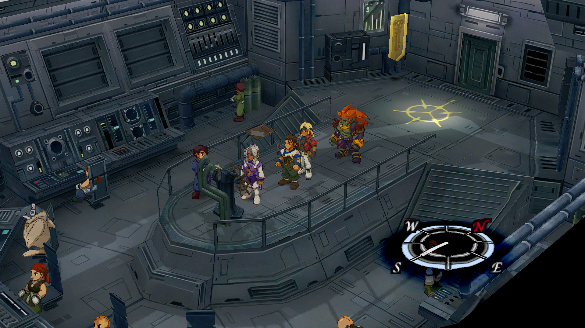

# Xenogears HD

A fan mod: Xenogears (PlayStation, 1998) in high resolution, with redrawn characters.

There are no game images here and there never will be — you need an image of your own disc. Xenogears belongs to Square Enix. This is a free fan work with no connection to the rights holder.

Русская версия: [README.ru.md](README.ru.md)

## Video

[All 34 Deathblows of Fei, Citan and Emeralda](https://www.youtube.com/watch?v=cxWjZwgbCas), recorded straight from the game (7 minutes).

## Why I did this

I first met Xenogears as a teenager, and the depth of its story struck me. I can't say I have played many JRPGs, but I consider this game's story one of the best in the genre.

Back then I didn't care about the graphics. Now, with AI tools around, I thought: why not try to give the game a second wind. I think something came of it. It is not perfect — it never could be.

As a test I played the game through, from the start to the credits. And I enjoyed it: it was a pleasure to watch familiar characters drawn in more detail.

## Thank you to the author of Weltall

This mod is not an emulator. The game runs on top of the open-source core [Weltall](https://github.com/Roman215/Weltall), which re-implements the logic of Xenogears. The core is not my work. Without it none of this would exist, and I want to say so at the top rather than in small print at the bottom.

Thanks to the Godot team as well: the shell is built on it.

## What is here

- **The port.** A Godot shell and a bridge to the Weltall core, with our patches to the core.
- **The HD texture pack.** Redrawn sprites of the heroes, story characters, townspeople, gears and some of the enemies, portraits, interface elements; improved scene textures. It began as a texture pack for RetroArch (the Beetle PSX HW core); in its present form (`.bc7` files) the stock core does not read it — see `sprites/bc7`.
- **The sources of everything.** The port, the checking tools and the whole pipeline the sprites were drawn with.

The scene textures come from a pack I bought several years ago from a private person; I no longer remember the author's name. If you recognise your work, write to me and I will credit you.

## What works

- The game can be played to the end, both discs.
- 3D scenes at screen resolution, sprites and interface from the HD pack, optional light and shadows.
- The language is the one on your disc: the American release and the Russian fan translation are supported.
- Quick saves, turbo, a cheat panel, brightening of dark scenes.
- The F6 key makes a "frame report": a screenshot, the data of that frame and a save in one folder. Most of the bugs were found with this tool, and it is the handy way to report new ones.

## What did not work out

Plainly:

- Not everything was redrawn well. Bart, for one, turned out to be hard.
- Some sprites may be off in colour: the same character can come out in slightly different shades from frame to frame.
- Some characters and monsters stay in their original pixels in places: the pack has no pictures for them.
- Text that is part of pictures (menus, the battle ring, the title) is in English.
- I played the game on the Russian translation's discs. The American discs were played far less, and the second American disc was not tried at all.
- The public build has no "find by content" index: that file holds the game's own sprite data, so I do not publish it. In places a sprite that is HD on my machine may stay in pixels in yours.
- It was tested on one computer.

I have neither the strength nor the wish to keep improving it. That is why I am publishing everything as it is, sources included. What to fix and whether to fix it is for each of you to decide; the rough spots we know of are noted in [docs/HOW_IT_WORKS.md](docs/HOW_IT_WORKS.md).

## How it was made, and what AI has to do with it

I have nothing to hide: the main work was done by AI.

1. ChatGPT redrew the character art from the old originals.
2. From that art Nano Banana drew reference sheets of the characters.
3. On those and on the original sprites I trained a model of my own.
4. That model drew all the frames.
5. The lion's share of the rest — the port, the tools, the pipeline, the bug hunting — was done by Claude. I wrote the instructions and looked for bugs and drawing flaws together with it.

More about the pipeline: [docs/SPRITES.md](docs/SPRITES.md).

## What it cost

I did not keep exact count. Roughly 500 dollars and two weeks of my time, I think. A lot of that time went into finding the approach: how best to set it all up, from the RetroArch emulator to a port on Godot.

## How to run it

1. Download the ready build `XenogearsHD_portable_nopack.zip` from the [Releases](../../releases) page and unpack it.
2. Download the HD pack `XenogearsHD_pack.zip` (9.8 GB): [Google Drive](https://drive.google.com/file/d/1YDdp8Z_BPnRCgyAuMYRyH30flTckT9Gc/view?usp=sharing). Unpack it into the build's folder: the archive holds a `pack` folder.
   SHA-256: `e488c54e3f712569989524a5b068532ff2952fe4e61e1bb0710fb30dd50fc0bf`
3. Put an image of your own disc 1 into the `Games` folder (BIN + CUE or CHD). Disc 2 goes there too; it is needed at the end of the first one.
4. Run `Play.cmd`.

You need Windows 10 or 11 and a video card with Vulkan or DirectX 12. Nothing has to be installed. Controls and the rest are in `README.txt` inside the build. Building from source: [docs/BUILD.md](docs/BUILD.md).

## Working with the sprites

- **To find a picture:** press F6 in the game. The frame report's `frame.txt` names the pack file of every sprite piece and interface element on the screen.
- **To look at it and change it:** `sprites/bc7/bc7_to_png.py` turns a pack file into a PNG. Edit it and put the PNG beside the original in the `pack` folder — the port takes a `.png` over a `.bc7` of the same name. Nothing has to be rebuilt.
- **To redraw whole characters:** the scripts in `sprites/` are the pipeline we used, as it is. They need your own extraction from your disc and your own model: the original sprites, the reference sheets and the trained weights are not published.

More: [sprites/bc7/README.md](sprites/bc7/README.md), [docs/SPRITES.md](docs/SPRITES.md).

## If you want to take it further

I hope this inspires someone, and perhaps you will make this game even better — I will only be glad.

And if what I have done dismays you, I ask your forgiveness.

Enjoy!

Verm

## Buy me a coffee

The mod is free and will stay free. If you would like to thank the author, a coffee is welcome:

USDT or TRX (Tron, TRC20): TKunB8DypdsH9s5CGaCTtTwGidbffz4iNH

## Rights

The code in this repository is under the MIT license (see `LICENSE`), except where `THIRD_PARTY.md` says otherwise; third-party parts and their licenses are listed there. Xenogears belongs to Square Enix. Neither the repository nor the build contains any files of the game.
