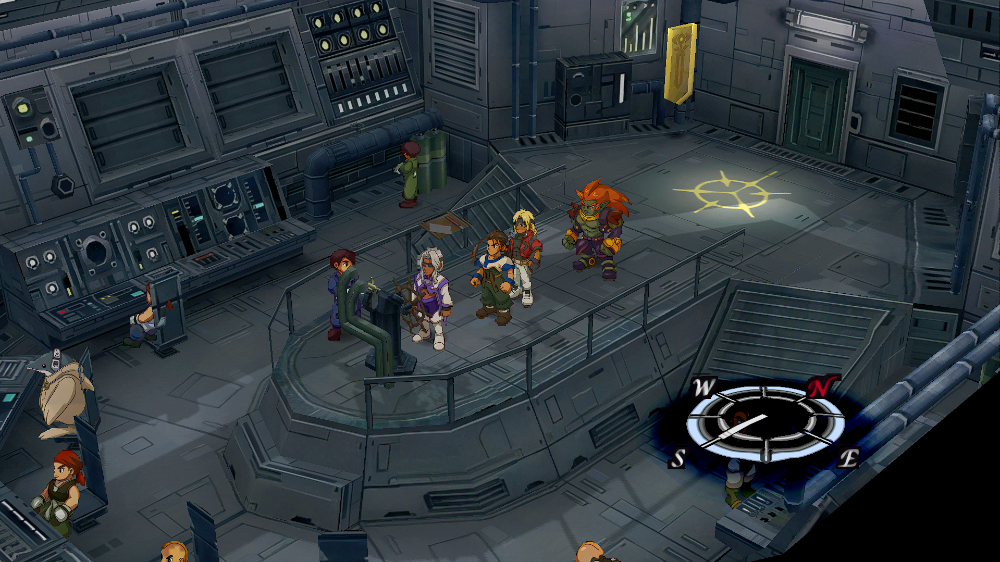

# Xenogears HD

Фанатский мод: Xenogears (PlayStation, 1998) в высоком разрешении и с перерисованными персонажами.

Образов игры здесь нет и не будет — нужен образ вашего собственного диска. Xenogears принадлежит Square Enix. Это бесплатная фанатская работа, с правообладателем она не связана.

English: [README.md](README.md)



## Видео

| [](https://www.youtube.com/watch?v=cxWjZwgbCas) | [](https://www.youtube.com/watch?v=Ez5WRn55g5s) |
|:---:|:---:|
| [Все 34 смертельных приёма Фея, Ситана и Эмеральды](https://www.youtube.com/watch?v=cxWjZwgbCas), запись прямо из игры (7 минут) | [Прогулка по Кислеву](https://www.youtube.com/watch?v=Ez5WRn55g5s): массовка в HD |

## Как запустить

### Шаг 1. Скачайте сборку

Откройте страницу [Releases](../../releases). В верхнем выпуске, в списке **Assets**, скачайте `XenogearsHD_portable_nopack.zip` (90 МБ). «Source code» качать не нужно.

Распакуйте архив куда угодно. Появится папка `XenogearsHD` — это и есть игра.

### Шаг 2. Скачайте HD-пак

Скачайте `XenogearsHD_pack.zip` (9,8 ГБ) с [Google Диска](https://drive.google.com/file/d/1YDdp8Z_BPnRCgyAuMYRyH30flTckT9Gc/view?usp=sharing). На GitHub его нет: он слишком большой.

В архиве одна папка `pack`. Положите её внутрь папки `XenogearsHD` из шага 1. Должно получиться так:

```
XenogearsHD\
    Play.cmd      <- запуск игры
    Games\        <- сюда образ диска (шаг 3)
    pack\         <- HD-пак
    ...
```

Если после распаковки вышло `XenogearsHD_pack\pack\`, перенесите саму папку `pack` в `XenogearsHD`.

SHA-256 архива: `e488c54e3f712569989524a5b068532ff2952fe4e61e1bb0710fb30dd50fc0bf`

### Шаг 3. Положите образ своего диска

Образ своего диска 1 — в папку `Games` (BIN + CUE или CHD). Диск 2 — туда же, он понадобится в конце первого.

### Шаг 4. Запустите `Play.cmd`

Нужны Windows 10 или 11 и видеокарта с Vulkan или DirectX 12. Устанавливать ничего не надо. Клавиши — ниже; остальные подробности — в `ПРОЧТИ.txt` внутри сборки (по-английски — `README.txt`). Как собрать из исходников — в [docs/BUILD.md](docs/BUILD.md).

## Управление

| Клавиша | Что делает |
|---|---|
| Стрелки | движение |
| X / Z / A / S | крестик / кружок / квадрат / треугольник |
| Enter / Backspace | Start / Select |
| Q, W / E, R | L1, R1 / L2, R2 |
| Tab (держать) | игра в 4 раза быстрее |
| F1 | панель читов |
| F2 | свет и тени вкл./выкл. |
| F3 | HD-текстуры вкл./выкл. |
| F4 | выиграть текущий бой |
| F5 / F9 | быстрое сохранение / загрузка |
| F6 | отчёт о кадре (снимок, данные кадра и сохранение в папке `reports`) |
| F7 | тёмные места светлее: выкл. / слабо / сильнее |
| F8 | вспышки в бою: как в игре / слабо / выкл. |
| F11 | во весь экран / в окне |

Геймпад работает: A / B / X / Y — крестик / кружок / квадрат / треугольник, LB / RB — L1 / R1, курки — L2 / R2, Start / Back — Start / Select.

## Зачем я это сделал

Я познакомился с Xenogears подростком, и меня поразила глубина её сюжета. Я не могу сказать, что играл во много JRPG, но сюжет этой игры считаю одним из лучших в жанре.

Тогда мне было всё равно на графику. А сейчас, когда появились инструменты ИИ, я подумал: почему бы не попробовать дать игре второе дыхание. Мне кажется, что-то получилось. Не идеально — идеально быть и не могло.

Как тест я прошёл игру целиком, от начала до титров. И прошёл с удовольствием: было приятно смотреть на знакомых персонажей в более подробной прорисовке.

## Спасибо автору Weltall

Этот мод — не эмулятор. Игра идёт поверх открытого ядра [Weltall](https://github.com/Roman215/Weltall), которое заново воспроизводит логику Xenogears. Ядро — не моя работа. Без него ничего этого не было бы, и я хочу сказать это в самом начале, а не в конце мелким шрифтом.

Спасибо и команде Godot: на нём сделана оболочка.

## Что здесь есть

- **Порт.** Оболочка на Godot и мост к ядру Weltall, с нашими правками ядра.
- **HD-пак текстур.** Перерисованные спрайты героев, сюжетных персонажей, массовки, гиров и части врагов, портреты, элементы интерфейса; улучшенные текстуры сцен. Он начинался как пак текстур для RetroArch (ядро Beetle PSX HW); в нынешнем виде (файлы `.bc7`) обычное ядро его не читает — см. `sprites/bc7`.
- **Исходники всего.** Порт, инструменты проверки и весь конвейер, которым рисовались спрайты.

Текстуры сцен — из пака, который я купил несколько лет назад у частного лица; имени автора я уже не вспомню. Если вы узнали свою работу — напишите, я укажу вас.

## Что получилось

- Игра проходится целиком, оба диска.
- 3D-сцены в разрешении экрана, спрайты и интерфейс из HD-пака, по желанию свет и тени.
- Язык — тот, что на вашем диске: поддерживаются американский выпуск и русский фанатский перевод.
- Быстрые сохранения, ускорение, панель читов, осветление тёмных сцен, ослабление или отключение вспышек в бою — клавиши в разделе [Управление](#управление).
- Клавиша F6 — «отчёт о кадре»: снимок, данные кадра и сохранение в одной папке. Этим инструментом найдена большая часть ошибок, им же удобно сообщать о новых.

## Что не получилось

Говорю как есть.

- Не всё удалось перерисовать хорошо. Тот же Барт оказался сложным.
- У некоторых спрайтов возможны неточности в цвете: один и тот же персонаж в разных кадрах может быть немного разных оттенков.
- Часть персонажей и монстров местами остаётся в исходных пикселях: для них в паке нет картинок.
- Надписи, вшитые в картинки (меню, кольцо боя, титул), английские.
- Я проходил игру на дисках русского перевода. С американскими играли гораздо меньше, второй американский диск не пробовали вовсе.
- Индекс «поиска по содержимому» я не выкладываю: в нём лежат исходные спрайты игры. Вместо него есть таблица имён, `data/sprite_alias_table.csv` (210 строк: хеши и имена файлов пака; числа ниже — для первых 146). Её записал сам индекс на моих прогонах: все карты с новой игры и из одной точки сюжета, около сотни моих сохранений за всю игру, все кадры спрайтов партии. Там она даёт ту же картинку, что и индекс: на картах с новой игры кусков спрайтов в пикселях остаётся 507 вместо 1653, в моих сохранениях — 1980 вместо 6931, у героев целиком в HD 2163 кадра из 2170 (без неё 2093). Там, где таблицу не собирали, она находит меньше: на проверке по местам, которые в неё не вошли, — примерно две трети того, что находит индекс. Поэтому маленькие пилоты в гирах и часть кадров Билли, Рико, Эмеральды и Чучу там, где я не проходил, могут остаться в пикселях. Как дописать строку: запустите игру из командной строки как `Play.cmd alias_record=record.csv` (файл появится в папке сборки), возьмите из него строку с `?`, впишите вместо `?` имя файла из пака и добавьте строку в таблицу. Что значит каждый столбец — написано в шапке таблицы.
- Проверено на одном компьютере.

Улучшать это дальше у меня больше нет ни сил, ни желания. Поэтому я и выкладываю всё как есть, вместе с исходниками. Что исправлять и исправлять ли — пусть каждый решает сам; известные нам недоделки записаны в [docs/HOW_IT_WORKS.md](docs/HOW_IT_WORKS.md).

## Как это сделано, и при чём тут ИИ

Мне нечего скрывать: основную работу сделал ИИ.

1. ChatGPT перерисовывал арты персонажей по старым образцам.
2. По этим артам Nano Banana рисовала эталонные листы персонажей.
3. На них и на оригинальных спрайтах я обучил собственную модель.
4. Эта модель нарисовала все кадры.
5. Львиную долю остального — порт, инструменты, конвейер, разбор ошибок — сделал Claude. Я писал инструкции и вместе с ним искал баги и недочёты прорисовки.

Подробно о конвейере — в [docs/SPRITES.md](docs/SPRITES.md).

## Сколько это стоило

Точно я не считал. Думаю, примерно 500 долларов и две недели моего времени. Много времени ушло на поиск подхода: как лучше всё устроить, от эмулятора RetroArch до порта на Godot.

## Как работать со спрайтами

- **Найти картинку:** нажмите F6 в игре. В отчёте о кадре, в файле `frame.txt`, названо имя файла пака для каждого куска спрайта и элемента интерфейса на экране.
- **Посмотреть и изменить:** `sprites/bc7/bc7_to_png.py` превращает файл пака в PNG. Отредактируйте его и положите PNG рядом с оригиналом в папку `pack` — порт берёт `.png` раньше, чем `.bc7` с тем же именем. Пересобирать ничего не нужно.
- **Перерисовать персонажей целиком:** скрипты в `sprites/` — конвейер, которым пользовались мы, как есть. Им нужны ваше собственное извлечение с вашего диска и ваша модель: оригинальные спрайты, эталонные листы и обученные веса не выложены.

Подробнее: [sprites/bc7/README.md](sprites/bc7/README.md), [docs/SPRITES.md](docs/SPRITES.md).

## Если хотите продолжить

Я надеюсь, что это кого-то вдохновит и, возможно, вы сделаете эту игру ещё лучше — я буду только рад.

А если то, что я сделал, повергнет вас в уныние — прошу у вас прощения.

Приятного пользования!

Verm

## На кофе

Мод бесплатный и таким останется. Если хочется сказать автору спасибо — буду рад чашке кофе:

USDT or TRX (Tron, TRC20): TKunB8DypdsH9s5CGaCTtTwGidbffz4iNH

## Права

Код в этом репозитории — под лицензией MIT (см. `LICENSE`), кроме случаев, оговорённых в `THIRD_PARTY.md`; чужие части и их лицензии перечислены там же. Xenogears принадлежит Square Enix. В репозитории и в сборке нет файлов игры.
